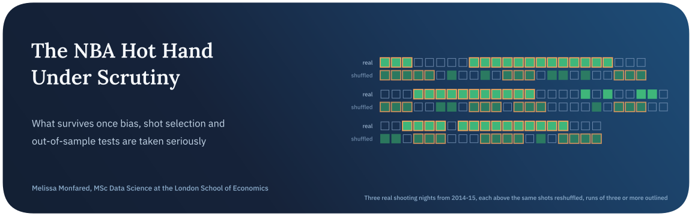
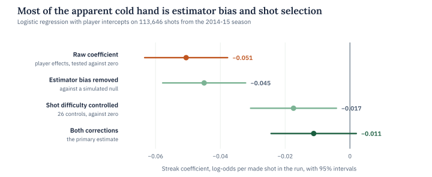
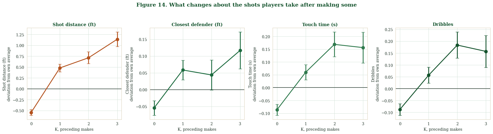
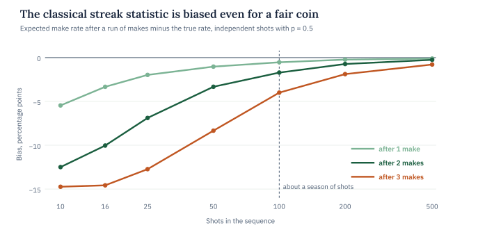
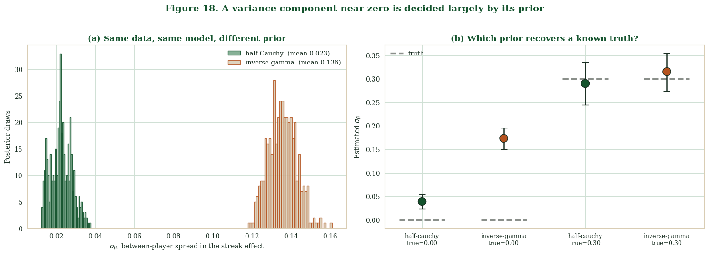
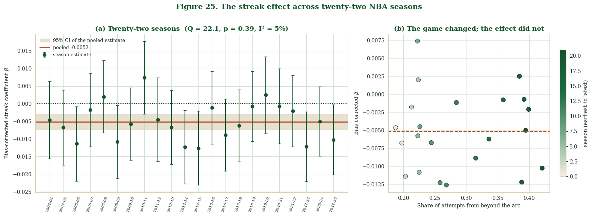

<p align="center">
  
</p>

<p align="center">
  
  
  
  
</p>

The basketball hot hand has been argued over for forty years. Gilovich, Vallone and Tversky found in 1985 that a make didn’t make the next make more likely, and the hot hand became a textbook cognitive illusion. In 2018 Miller and Sanjurjo proved that the statistic behind that conclusion is biased even for independent coin flips, which reopened the whole question.

This project treats the argument as a question about estimators rather than a yes or no about basketball. It asks how the evidence for short-term dependence in NBA shooting changes as each analytical decision is made properly, from finite-sample bias and shot difficulty to player heterogeneity, latent states and out-of-sample prediction. It then checks the methods themselves on simulated data where the truth is known.

> **In short.** Read naively, 2014-15 NBA shooting looks like a cold hand, with a streak coefficient of −0.051 and a p-value near 10⁻¹⁴. Most of that is the estimator’s own bias plus the harder shots players take after making a few. What remains is a small negative coefficient of about −0.011 that doesn’t clear its own simulated null and adds nothing to predicting the next shot. The same small negative pattern holds across 22 seasons.

## Key findings

| Finding | Evidence |
| :-- | :-- |
| The classical statistic is biased in exactly the range that matters | For three fair coin flips the expected share of heads after a head is 5/12, not 1/2. At 100 shots the shortfall after three makes is still 4 percentage points |
| Player-by-player tests find nothing | 8 of 248 players clear p < 0.05 against their own reshuffled games, fewer than the 12.4 chance predicts, and none survives a false-discovery-rate correction |
| Players take harder shots after makes | Relative to their own average, players shoot from 0.5 feet closer after a miss and 1.1 feet farther after three makes, and they hold the ball longer and dribble more |
| Shot difficulty explains most of the effect | Difficulty controls remove 66% of the raw streak coefficient, and against a simulated null the remainder is −0.011 (z = −1.67, p ≈ 0.10) |
| Players barely differ from one another | A hierarchical Bayesian model puts the spread of player streak effects at 0.023, below the 0.039 the same model returns on simulated data with no spread at all |
| No hidden hot state | A two-state hidden Markov model fitted to convergence collapses into one state, its two shooting rates ending 0.003 apart |
| Streaks don’t help prediction | On held-out games, shot difficulty adds 0.095 to ROC-AUC, and the streak term adds 0.0001 |
| The pattern holds across eras | Over 22 seasons and 4.45 million shots the pooled corrected coefficient is −0.005 (95% CI −0.007 to −0.003), with no real variation between seasons (I² = 5%) |

<picture>
  <source media="(prefers-color-scheme: dark)" srcset="assets/decomposition-dark.svg">
  
</picture>

## Conclusion

The cold hand that appears in the raw data is mostly an artefact of method. About a ninth of the raw coefficient is the streak-selection bias that Miller and Sanjurjo identified, which persists even inside a logistic regression. Two thirds is shot selection, since players move about 1.7 feet farther from the basket after three makes than after a miss. What survives both corrections is a coefficient near −0.01 that sits about 1.7 standard deviations from its simulated null.

That small remainder deserves a careful reading rather than a verdict. A better-fitting model with a distance-by-defender interaction pushes it to −0.014 with p = 0.039, so the sign is stable. The measured controls still say nothing about who was defending or how hard the shot was contested at release, and better difficulty measurement would be expected to shrink the estimate further. A psychological cold hand is the least likely reading of it.

The simulation study sets the limits on all of this. With no hot hand present, testing the regression coefficient against zero rejected in 4 of 40 replications against 2 of 40 for the simulated null, and every method detected a real effect of 0.10 in log-odds every time. A latent hot-and-cold process with no streak mechanism at all also produced a significant streak coefficient in 97.5% of replications, so even a clear positive result here couldn’t have identified the mechanism behind it.

## The data

The main dataset is the NBA shot log for the 2014-15 regular season, 128,069 field-goal attempts by 281 players across 904 games. Unlike the archive below, it records the distance to the nearest defender, along with touch time and dribbles, which is what makes the shot-difficulty adjustment possible. Before any model was fitted, the notebook found 312 impossible negative touch times and a shot clock missing on 4.35% of shots. It also found 92 player-games with an unrecorded shot, and streaks reset at every such gap so they are never built from shots that weren’t consecutive. That leaves 113,646 shots with an observed predecessor.

A second archive of 4,450,789 attempts from 2003-04 to 2024-25 adds court coordinates and shot-type labels but has no defender data, so it serves as an independent check and an extension across eras rather than a replacement. Shot order is rebuilt from the game clock, and shots with tied timestamps are left out rather than ordered arbitrarily.



*What changes after a run of makes, measured against each player’s own average. Shots move farther out, and players hold the ball longer and dribble more.*

## Methods

| Question | Method | Result |
| :-- | :-- | :-- |
| How large is the selection bias? | Exact enumeration for short sequences, then Monte Carlo | 5/12 at three flips, 4 points at 100 shots after three makes |
| Which estimator should be used? | Monte Carlo study of bias, variance, MSE and coverage | The permutation-corrected statistic removes the bias and lowers MSE in 11 of 12 settings |
| Is any player streaky? | Within-game permutation tests for 248 players with Benjamini-Hochberg correction | None survives |
| Does the regression inherit the bias? | Logistic regression on simulated independent shooting | Yes, its null centres at −0.006 rather than zero |
| Is it shot selection? | Logistic regression with player intercepts and 26 difficulty controls, judged against a simulated null | Corrected coefficient −0.011, p ≈ 0.10 |
| Does the model fit? | Binned residuals and a distance-by-defender interaction | 10 of 20 bins misfit without the interaction and 3 with it |
| Is the effect nonlinear? | Streak terms of increasing flexibility, compared by likelihood-ratio tests | Linear is adequate (p = 0.22 and 0.35) |
| Do players differ? | Hierarchical logistic model fitted by Pólya-Gamma Gibbs sampling, with a prior-recovery simulation | Spread of 0.023 under a half-Cauchy prior, 0.136 under an inverse-gamma |
| Is hotness a hidden state? | Two-state hidden Markov model by Baum-Welch, run to convergence | Collapses to a single state |
| Do streaks predict? | Logistic regression and gradient boosting on a chronological split | Streak adds 0.0001 to 0.0003 in ROC-AUC |
| Which methods can be trusted? | Recovery study across five known data-generating processes | Full power at 0.10, but a streak cannot be told apart from a latent state |
| Is it stable over time? | Season-by-season models with their own nulls, pooled with Cochran’s Q | Q = 22.1 on 21 df, p = 0.39 |

<picture>
  <source media="(prefers-color-scheme: dark)" srcset="assets/bias-dark.svg">
  
</picture>



*The heterogeneity answer depends on the prior. On the same data the two priors disagree by a factor of six, and only the half-Cauchy comes close to zero when the true spread is zero.*



*Twenty-two seasons, each against its own simulated null. The share of threes more than doubled over the period, and the streak coefficient didn’t move with it.*

## Limitations and next steps

The tracking log covers 63% of the season’s shots, 281 of 490 players and 904 of 1,230 games, so every tracking-data result rests on a subset that may not be random. It holds field goals only, and the difficulty controls can’t see who was defending or how hard the shot was contested at release. Power was established at effects around 0.10 in log-odds, an order of magnitude above the estimate, and the simulated nulls use 150 to 200 draws, enough for a normal approximation but not for precise tail probabilities.

Free throws, where the shot never changes, would remove the shot-selection channel altogether, and richer data on how each shot was contested would test whether the remaining negative coefficient shrinks as expected.

## Running it

The notebook runs on Kaggle with two datasets attached, the NBA shot logs for 2014-15 (`shot_logs.csv`) and the season-by-season shot archive for 2003-04 to 2024-25. Everything else, including the Pólya-Gamma sampler and the hidden Markov model, is written out in the notebook itself.

```bash
pip install numpy pandas scipy statsmodels scikit-learn matplotlib seaborn
jupyter notebook the-nba-hot-hand-under-scrutiny.ipynb
```

## Repository

```text
.
├── the-nba-hot-hand-under-scrutiny.ipynb   data quality, bias theory, permutation and Bayesian models, HMMs, prediction and the 22-season extension
├── assets/                                  figures used in this README
└── README.md
```

## About

Made by Melissa Monfared, MSc Data Science at the London School of Economics. More projects live on [my website](https://melissamonfared.github.io). I also post notebooks on [Kaggle](https://kaggle.com/melissamonfared) and I’m on [LinkedIn](https://linkedin.com/in/melissamonfared).

Shot data from the NBA, through the public shot-log and shot-archive datasets on Kaggle.
